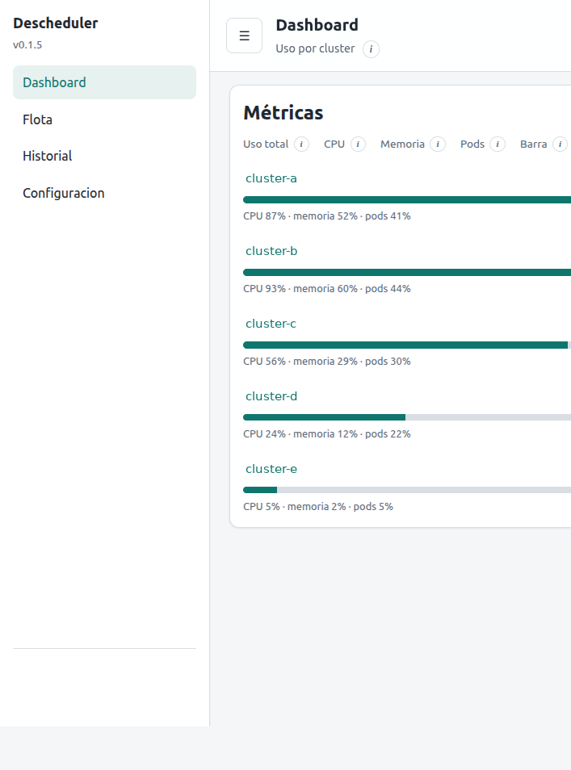
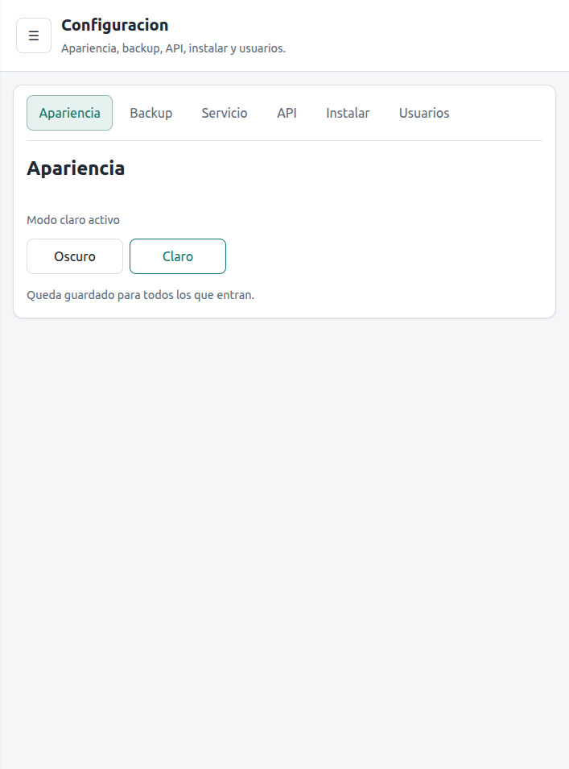
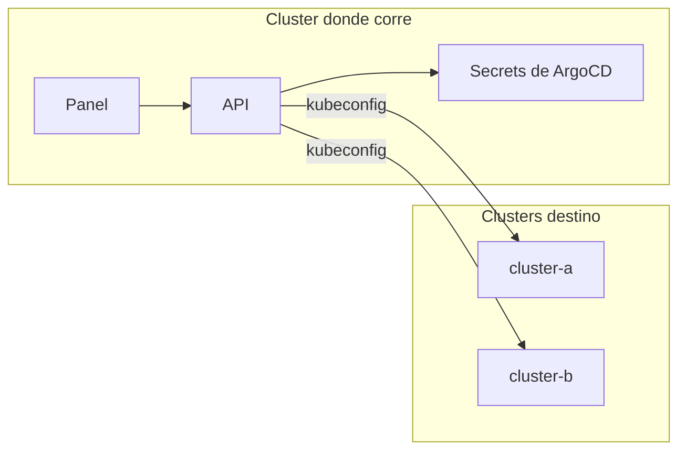

# Doctor Descheduler

[](LICENSE)
[](https://www.python.org/downloads/)
[](https://github.com/ghcetraro/doctor-descheduler/actions/workflows/ci.yml)
[](https://kubernetes.io/)

**Un solo proceso rebalancea varios clusters** — escrito en Python, pensado para Kubernetes.

Doctor Descheduler corre en un cluster y, cada 15 minutos, entra a los demás usando el kubeconfig que ArgoCD ya guarda. Aplica la policy **LowNodeUtilization**: si un nodo está muy cargado y otro muy libre, evicta pods (o solo lo anota, si está en dry-run).





---

## El problema

Cuando hay más de un cluster, el descheduler oficial hay que instalarlo en cada uno: un CronJob, un RBAC y una policy por destino. Si cambia el umbral, se cambia N veces. Y no hay un lugar solo para ver qué pasó en todos.

## La solución

1. **Un proceso** lee los secrets de cluster de ArgoCD.
2. **Mide** CPU, memoria y pods como requests / allocatable.
3. **Marca** nodos altos (más de 60 %) y bajos (menos de 15 %).
4. **Evicta** pods que pueden moverse, o los lista si `DRY_RUN=true`.
5. **Muestra** la flota, el log en vivo y el historial en un panel.



---

## Características

| Área | Detalle |
|------|---------|
| **Policy** | LowNodeUtilization. Nodo alto por encima de 60 %. Nodo bajo por debajo de 15 %. |
| **Qué no mueve** | DaemonSet, Job, pods con PVC, almacenamiento local, prioridad crítica, afinidad required. Mínimo 2 réplicas. |
| **Dry-run** | `DRY_RUN=true` por defecto en este repo. Anota la pasada y no evicta. |
| **Manual** | Botón Ejecutar por cluster, con spinner y log mientras corre. |
| **Apariencia** | Claro u oscuro, guardado en un ConfigMap del namespace. |
| **Auth** | Login local. OpenID Connect opcional, apagado por defecto. |

---

## Limitaciones

- **No reemplaza al chart oficial** si se quiere el binario `descheduler` de Kubernetes SIGs. Esta app hace la misma policy, en Python, desde un solo lugar.
- **El uso es de requests**, no de métricas en vivo. Si los requests no reflejan la carga real, la decisión tampoco.
- **Con `DRY_RUN=false` mueve pods.** Un pod evictado se recrea en otro nodo; hay una ventana de corte.
- **Depende de ArgoCD.** El kubeconfig sale del secret de cada cluster (`ARGOCD_NAMESPACE`, default `argocd`). Sin ese secret, ese destino queda sin conexión.
- **Namespaces de sistema** (`kube-system`, `argocd`, `cert-manager`, `descheduler`) quedan afuera. Sumá los de tu plataforma en el código de policy.

---

## Stack

- Python 3.12, FastAPI, cliente de Kubernetes.
- Panel Jinja2. SQLite local para usuarios y tokens del panel.
- Dos imágenes: `software/backend` (API) y `software/frontend` (panel).

---

## Arranque rápido

```bash
cp .env.example .env
# Editá API_TOKEN, SESSION_SECRET y SERVICE_PASSWORD (mínimo 6 caracteres).

docker compose up --build
```

Panel: `http://localhost:8080` · API: `http://localhost:8000` · health: `GET /health`.

Usuario local de ejemplo: el de `SERVICE_USER` / `SERVICE_PASSWORD` (en el ejemplo, `admin` / `change-me`).

Sin Docker:

```bash
cd software/backend
python -m venv .venv && . .venv/bin/activate
pip install -r requirements.txt
API_TOKEN=change-me-token DRY_RUN=true uvicorn app.main:app --port 8000
```

En otra terminal, el panel:

```bash
cd software/frontend
python -m venv .venv && . .venv/bin/activate
pip install -r requirements.txt
BACKEND_URL=http://127.0.0.1:8000 API_TOKEN=change-me-token \
  SESSION_SECRET=change-me-session SERVICE_PASSWORD=change-me \
  uvicorn app.main:app --port 8080
```

El proceso tiene que correr **dentro** del cluster donde está ArgoCD (service account con lectura de esos secrets y permiso de eviction en los destinos). En una laptop, sin ese acceso, la flota va a figurar sin conexión: el panel igual levanta.

Pasar a modo real, solo cuando ya se vio un dry-run:

```bash
DRY_RUN=false
```

---

## Configuración

| Variable | Default en este repo | Para qué |
|----------|----------------------|----------|
| `API_TOKEN` | vacío (hay que setearlo) | Token de la API |
| `DRY_RUN` | `true` | `true` anota; `false` evicta |
| `CLUSTER_IDS` | `cluster-a,cluster-b` | Nombres, los mismos que los secrets de ArgoCD |
| `INTERVAL_SECONDS` | `900` | Cada cuánto corre solo |
| `ARGOCD_NAMESPACE` | `argocd` | Dónde están los secrets de cluster |
| `SESSION_SECRET` | `change-me-session` | Firma de la cookie del panel |
| `SERVICE_USER` / `SERVICE_PASSWORD` | `admin` / `change-me` | Login local |
| `OIDC_ENABLED` | `false` | OpenID Connect |
| `LOG_LEVEL` | `info` | `debug`, `info`, `warning`, `error` |

Ejemplo de variables para un despliegue propio: [helm/values.example.yaml](helm/values.example.yaml).

---

## Endpoints

| Ruta | Descripción |
|------|-------------|
| `GET /health` | Salud, sin auth |
| `GET /api/v1/fleet` | Estado de cada cluster |
| `POST /api/v1/clusters/{id}/run` | Pasada manual (bloquea hasta terminar) |
| `GET /api/v1/clusters/{id}/progress` | Log en vivo de esa pasada |
| `GET /api/v1/appearance` | Tema `light` o `dark` |
| `POST /api/v1/appearance` | Guarda el tema |

---

## Documentación

- [Presentación](docs/PRESENTACION.md)
- [Textos para LinkedIn](docs/speech-linkedin.md)
- [Changelog](CHANGELOG.md)
- [Contribuir](CONTRIBUTING.md)
- [Seguridad](SECURITY.md)

---

## Seguridad

El default es dry-run. Antes de `DRY_RUN=false`, revisá qué pods puede mover y en qué namespaces. Ver [SECURITY.md](SECURITY.md).

---

## Licencia

[MIT](LICENSE) — Copyright (c) 2026 Gabriel Cetraro

---

## Autor

Proyecto open source de **Gabriel Cetraro** — automatización de infraestructura y Kubernetes.

Si te resulta útil, una estrella en GitHub ayuda a que se vea.
